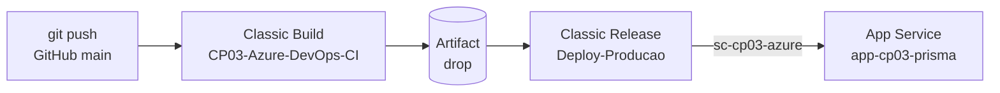

# FIAP | CP03 — Azure DevOps CI/CD

Aplicação Node.js publicada no **Azure App Service** por uma esteira **Classic** do Azure DevOps, disparada a partir de um repositório GitHub.



## Objetivo

Demonstrar um fluxo completo de integração e entrega contínuas: um push na branch `main` deve gerar uma nova Build, um novo Artifact e uma nova Release, atualizando a aplicação pública sem deploy manual.

## Tecnologias

| Item | Detalhe |
|---|---|
| Aplicação | Node.js + Express 4 (`app/index.js`) |
| Monitoramento | `applicationinsights` (ativo só se `APPLICATIONINSIGHTS_CONNECTION_STRING` estiver definida) |
| Banco | `mssql`, usado apenas na rota `/tema` |
| CI/CD | Azure DevOps — Build Pipeline Classic e Release Pipeline Classic |
| Hospedagem | Azure App Service (Linux) |
| Código | GitHub |

## Links

| Recurso | Link |
|---|---|
| Repositório | <https://github.com/joaoharv/atividade-azure-devops> |
| Projeto Azure DevOps | <https://dev.azure.com/RM564212/CP03-Azure-DevOps> |
| Aplicação pública | <https://app-cp03-prisma-e6enhqhrfffch2f4.brazilsouth-01.azurewebsites.net/> |

Demais links (pipeline, App Service no portal) estão em [entregaveis/links.md](entregaveis/links.md).

## Como funciona

**Build Pipeline Classic** (`CP03-Azure-DevOps-CI`): lê o GitHub, branch `main`, e publica o Artifact `drop`. As tasks exatas estão em [docs/build-pipeline.md](docs/build-pipeline.md) e precisam ser conferidas na interface.

**Artifact** (`drop`): pacote da aplicação consumido pela Release. Ver [docs/artifact.md](docs/artifact.md).

**Service Connection** (`sc-cp03-azure`): conexão Azure Resource Manager que autoriza a Release a publicar na subscription Azure for Students. Nenhuma credencial é guardada neste repositório. Ver [docs/service-connection.md](docs/service-connection.md).

**Release Pipeline Classic** (`New release pipeline`, stage `Deploy-Producao`): recebe o Artifact e publica no App Service `app-cp03-prisma`. Ver [docs/release-deploy.md](docs/release-deploy.md).

**Gatilhos:** a Build tem integração contínua na `main` (a confirmar na interface) e a Release tem o gatilho de Continuous Deployment habilitado para o Artifact. O fluxo completo depois de um push ainda não foi comprovado. Ver [docs/teste-automacao.md](docs/teste-automacao.md).

> O workflow `.github/workflows/main.yml` foi deixado apenas com `workflow_dispatch` para não competir com o Azure DevOps. O deploy oficial é feito só pelas pipelines Classic.

## Executar localmente

Requer Node.js (a Build antiga usava 22.x).

```bash
cd app
npm install
npm start
```

Acesse <http://localhost:8080>. A rota `/tema` retorna erro 500 sem as variáveis `DB_USER`, `DB_PASSWORD`, `DB_SERVER` e `DB_NAME` e sem ajustar a consulta SQL do código.

## Estado da implementação

| Etapa | Estado |
|---|---|
| Build Classic executada e Artifact publicado | Confirmado pelo autor; print pendente |
| Release-1 / Deploy-Producao concluída | Confirmado pelo autor; print pendente |
| Aplicação pública acessível | Confirmado pelo autor |
| Alteração visual do badge no código | Feita localmente, **ainda não enviada ao GitHub** |
| Push automático gerando Build, Artifact e Release | **Pendente** |
| Professor com acesso Basic | **A verificar** |

## Evidências e entrega

Central de entrega em [entregaveis/](entregaveis/README.md): [checklist](entregaveis/checklist.md), [links](entregaveis/links.md) e pastas de [evidências](entregaveis/evidencias/). As imagens serão adicionadas depois, a partir do Azure DevOps e do Portal Azure.

## Limitações e melhorias futuras

- O Artifact foi publicado com cerca de 17 mil arquivos por incluir `node_modules`, o que deixa a publicação lenta. Uma opção é publicar só `index.js`, `package.json` e `package-lock.json` e deixar o App Service instalar as dependências. Isso exige mudar a Build e/ou configurações do App Service, o que não foi feito.
- Não há scripts `build` nem `test` no `package.json`; a "validação" da Build se limita a instalar dependências e checar o que estiver configurado.
- A rota `/tema` devolve `err.message` ao cliente e usa uma tabela de exemplo.
- Pipelines Classic não ficam versionadas no repositório; a configuração é documentada em `docs/`.
