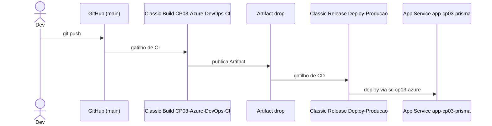

# Arquitetura CI/CD

## Componentes

| Componente | Valor | Estado |
|---|---|---|
| Repositório | `joaoharv/atividade-azure-devops`, branch `main` | Confirmado |
| Organização / projeto | `RM564212` / `CP03-Azure-DevOps` | Confirmado |
| Build | `CP03-Azure-DevOps-CI` (Classic Editor) | Confirmado |
| Artifact | `drop` | Confirmado |
| Service Connection | `sc-cp03-azure` | Confirmado |
| Release | `New release pipeline`, stage `Deploy-Producao` | Confirmado |
| App Service | `app-cp03-prisma` (Linux), grupo `rg-cp03-devops` | Confirmado |
| Subscription | Azure for Students | Confirmado |

## Decisões

- Pipelines **Classic**, conforme exigido; não há YAML de pipeline neste repositório.
- O workflow do GitHub Actions ficou somente manual para evitar um segundo deploy.
- Nenhum segredo é guardado no Git; a autenticação fica na Service Connection.
